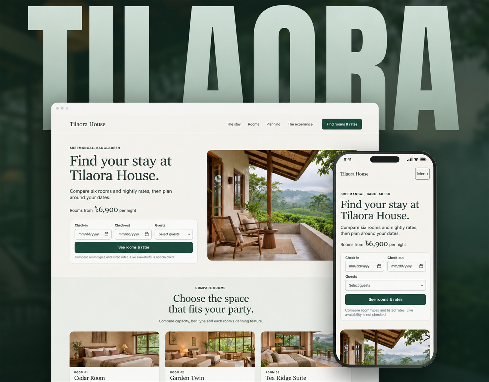

# Tilaora House | Boutique Stay Website Design

A self-initiated responsive hospitality website concept set in Sreemangal, Bangladesh, by Ahasanul Karim Khan.

- [Website prototype](index.html)
- [Open the live landing page](https://ahasanulkarimkhan-uiux.github.io/tilaora-house/)
- [Case study](case-study.html)
- [Behance cover](tilaora-behance-cover.jpg)
- [Full case-study JPG](tilaora-house-case-study-updated-2026-11-18.jpg)
- [Published Behance project](https://www.behance.net/gallery/258553487/Tilaora-House-Boutique-Stay-Website-Design)

The first screen shows a starting nightly rate and a date and guest search. Search filters six showcased room types by guest capacity and carries the chosen dates and guest count into a local stay review. Room cards show listed rates and a contact step follows room selection.

This is a portfolio concept. The property, rooms, rates, contact details, and generated imagery are illustrative. The prototype does not check live availability, send guest details, reserve a room, or take payment.

## Design decisions

| Decision | Purpose |
| --- | --- |
| Show search and starting rate in the hero | Let guests begin with dates, party size, and price. |
| Filter showcased rooms by capacity | Present room types that fit the selected party size. |
| Carry stay choices forward | Avoid asking for dates and guests again in the contact step. |
| Keep the review local | Show a sample subtotal without implying an actual reservation. |

## Files

`index.html` and `case-study.html` are standalone HTML, CSS, and JavaScript files. The `assets/` folder contains the images referenced by those pages. Open `index.html` to inspect the prototype and `case-study.html` to inspect the case study.

The cover and case-study JPG are upload assets. The case-study JPG was converted from the owner's full-page screenshot of the updated HTML on 18 November 2026.

© 2026 Ahasanul Karim Khan. All rights reserved.
